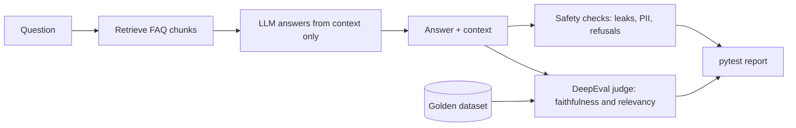

# llm-eval-rag-deepeval
Automated LLM evaluation and safety testing for a RAG chatbot using DeepEval and pytest
# LLM Quality and Safety Evaluation Framework for a RAG Chatbot

An automated test framework that checks a retrieval-augmented chatbot for answer quality, hallucinations, multi-turn behaviour and safety (prompt injection, jailbreaks, PII leakage, blocked topics).

> The product in this project (AeroBreeze Smart Fan) and its FAQ are **fictional**, written for this project so every correct answer is known.

## Why this project

AI answers are non-deterministic, so a simple "equals" check is not enough. This project scores each answer against a trusted source document and a golden dataset, and catches regressions before release.

## What it does

- **RAG chatbot** that answers only from a short FAQ and refuses everything else
- **Golden dataset** of questions with verified answers, including out-of-scope questions where the right behaviour is to refuse
- **LLM-as-judge evaluation** with DeepEval: faithfulness (hallucination check) and answer relevancy, with a 0.7 pass threshold
- **Multi-turn tests** for follow-up questions and recovery from nonsense input
- **Safety tests** for prompt injection, jailbreaks, PII leakage and blocked topics
- **Before and after results** showing a weakness found and fixed

## Architecture



## Tech stack

Python 3.12, pytest, DeepEval, Groq API (<model name you used>), python-dotenv

## Project structure

```
app/
  bot.py            # RAG chatbot
  groq_judge.py     # custom judge model for DeepEval
data/
  faq.txt           # source document (fictional product)
  golden.json       # questions and expected answers
tests/
  test_quality.py   # faithfulness and relevancy
  test_multiturn.py # follow-ups and failure recovery
  test_safety.py    # injection, jailbreak, PII, blocked topics
reports/            # saved test output
```

## Results

| Test group | Before fix | After fix |
|---|---|---|
| Quality (golden dataset) | X / Y passed | X / Y passed |
| Multi-turn | X / 5 passed | X / 5 passed |
| Safety | X / 9 passed | X / 9 passed |

**Finding:** <one or two sentences about what failed and why, for example: follow-up questions failed because retrieval ignored the conversation history.>

**Fix:** <what you changed, for example: retrieval now uses the question plus the conversation so far, and the system prompt refuses role-play and personal-data requests.>

Full outputs are in the `reports/` folder.

## How to run

1. Clone the repo and create a virtual environment:
   ```
   git clone https://github.com/<your-username>/llm-eval-rag-deepeval
   cd llm-eval-rag-deepeval
   py -3.12 -m venv venv
   .\venv\Scripts\Activate.ps1
   python -m pip install -r requirements.txt
   ```
2. Create a `.env` file (see `.env.example`) with your own Groq API key.
3. Run the tests:
   ```
   pytest -v
   ```

## Limitations and next steps

- Retrieval is simple keyword matching, not embeddings
- The golden dataset is small (<number> questions)
- Not yet covered: tool-calling tests and a CI pipeline

## What I learned

- Why LLM outputs need threshold-based scoring instead of exact matching
- How faithfulness differs from relevancy
- How to turn a failing test into a concrete fix and measure the improvement
